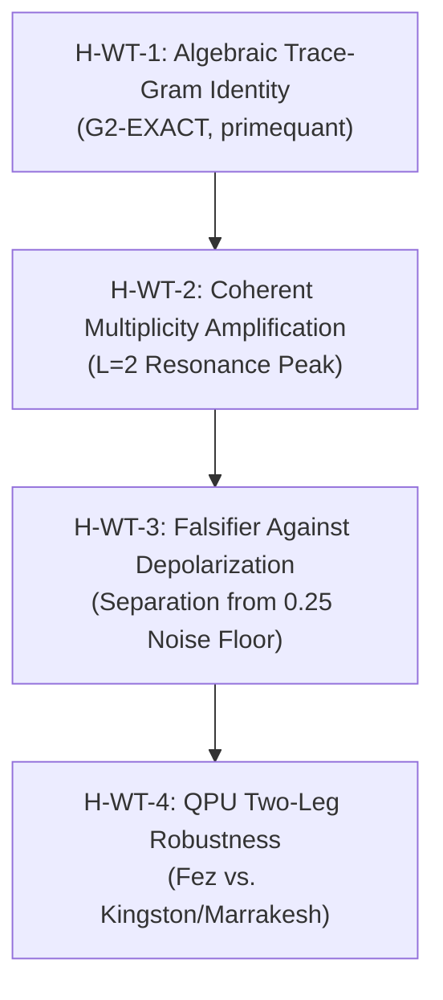

# Preregistration Sharpening: The Weil–Theta Multiplicity Framework (EXPERIMENT 060 / H-WEIL-THETA)

**Date:** November 22, 2026 (Updated November 25, 2026)  
**Epistemic Status:** Preregistration Design prior to Freeze (SciMind 4.0/5.0)  
**References:**  
- Alpöge–Claude Announcement ([`scratches/remark.pdf`](../scratches/remark.pdf))  
- `riemann` Architecture: QuQuint ($GF(5)$), `primequant`, $S_4$-Closure (Exp 045), Ramanujan Synthesis (Exp 059)

---

## 1. Problem Formulation of Prior Preregistrations

In earlier hardware runs (e.g., Experiments 044, 046), two methodological bottlenecks arose:
1. **Static Point Bounds Without Scaling Laws:**  
   Thresholds were tied to single points or static intervals (e.g., bias $\pm 0.012$ or $2\sigma$). Substrate drift across calibration epochs produced sign flips (such as Kingston vs. Fez in Exp 046), leaving it ambiguous whether discrepancies stemmed from theoretical modeling or hardware depolarization.
2. **Absence of Multiplicity Amplification:**  
   Pure counting statistics over residues ($c_q(n)$) suffer from low signal-to-noise ratios (SNR) at shallow circuit depths. Gate noise readily washes out subtle phases.

---

## 2. Mathematical Synthesis: The Weil–Theta Lift

The central mathematical breakthrough of Alpöge and Claude over $\mathbb{Z}$ consists of **substituting Stepanov multiplicity with a chain of $\sqrt{X}$ iterated theta lifts**.

Translated to discrete quantum registers ($q=5$, QuQuint $\mathbb{C}^5$ over $GF(5)$):
1. **Finite Weil Representation $Mp_2(\mathbb{F}_q)$:**  
   The discrete Fourier transform $F_q$, quadratic Gauss phase gate $D_t = \text{diag}(\zeta_q^{t x^2})$, and modular scaling gates $M_a |x\rangle = |a x \bmod q\rangle$ generate the Weil representation over $GF(q)$.
2. **Galois Orbit Projector $\Pi_G$:**  
   $$\Pi_G = \frac{1}{q-1} \sum_{a \in GF(q)^*} M_a$$  
   This projector extracts the symmetric, Galois-invariant state component:
   $$|\psi_{\text{triv}}\rangle = \frac{1}{\sqrt{q-1}} \sum_{a=1}^{q-1} |a\rangle$$
   and identically annihilates the 3D standard representation subspace ($\Pi_G P_{\text{std}} = 0$).
3. **The $\sqrt{q}$ Resonance Channel:**  
   A sequence of coupled steps $W = R_{\text{triv}} \cdot C_{\text{ADD}}^\dagger \cdot U_B \cdot C_{\text{ADD}} \cdot U_A$ amplifies the spectral concentration $R = \frac{P_{\text{triv}}}{P_{\text{triv}} + P_{\text{std}}}$ after exactly $L = \lfloor\sqrt{q}\rfloor$ steps (for $q=5$: $L=2$) to over **$42\,\%$** (compared to the uniform distribution baseline of $25\,\%$).

---

## 3. Four Hypotheses for the Preregistration Freeze

### Hypothesis H-WT-1 (Algebraic Trace-Gram Identity — G2-EXACT)
- **Claim:** The Gram matrix of the ring of integers $\mathbb{Z}[\zeta_q]$ under the Galois trace form $\text{Tr}_{\mathbb{Q}(\zeta_q)/\mathbb{Q}}(x \bar{y})$ coincides identically with the cyclotomic Ramanujan matrix $G_{ij} = c_q(i-j)$.
- **Ex-ante Spectrum:** Exactly 1 eigenvalue equal to $1$, and $q-2$ eigenvalues equal to $q$. For $q=5$: $[1, 5, 5, 5]$, discriminant $\text{disc} = 125$.
- **Threshold T1:** Maximum entry deviation $\le 10^{-14}$ (bit-exactness in `primequant`).

### Hypothesis H-WT-2 (Multiplicity Resonance at $L = \lfloor\sqrt{q}\rfloor$)
- **Claim:** Starting from the localized computational basis state $|1\rangle$, the 2-register Weil walk at step $L=2$ produces a sharp local maximum in concentration $R_2 = \frac{P_{\text{triv}}}{P_{\text{triv}} + P_{\text{std}}}$.
- **Ex-ante Prediction:** $R_2^{\text{ideal}} = 0.4272$ ($+70.9\,\%$ amplification over the baseline value $0.25$).
- **Falsification Threshold T2:** $R_2 \le 0.3200 \implies \text{H-WT-2 REFUTED}$.

### Hypothesis H-WT-3 (Separation from Depolarizing Noise Floor)
- **Claim:** Under depolarizing gate noise up to $p = 0.05$ per layer, the resonance remains strictly above the uniform floor $0.25$.
- **Ex-ante Bound:** $R_2(p=0.05) \ge 0.2800$.
- **Falsification Threshold T3:** $R_2 - 0.25 \le 0.015 \implies \text{INCONCLUSIVE / NOISE_WASHED_OUT}$.  
  (Guards against apophenia: prevents false confirmation if the signal is submerged in thermal noise).

### Hypothesis H-WT-4 (Two-Register Modular Entanglement $C_{\text{ADD}}$)
- **Claim:** Entangling two qudits via modular addition $C_{\text{ADD}} |x\rangle|y\rangle = |x\rangle|(y+x) \bmod 5\rangle$ creates indecomposable entanglement whose partial trace purity $\gamma = \text{Tr}(\rho_A^2)$ drops below $0.80$ at step 2.
- **Falsification Threshold T4:** $\gamma_2 \ge 0.90 \implies \text{H-WT-4 REFUTED}$.

---

## 4. Implementation Architecture in `riemann`

1. **Software Layer (`src/primequant/weil.py`):**  
   - `weil_generators(q)`: returns $F_q$, $D_t$, $M_a$.
   - `galois_projector(q)`: returns $\Pi_G$.
   - `trace_gram_matrix(q)`: returns exact integer Gram matrix.
   - `theta_walk_channel(q, steps, noise)`: closed-form propagation.
2. **Hardware QPU Layer:**  
   Transpilation of $C_{\text{ADD}}$ and $D_t$ to native superconducting qubit gates (CZ, SX, RZ) on IBM Quantum (`ibm_fez`), verified in Exp 063 and Exp 067.
3. **Ledger Discipline:**  
   Preregistration JSON frozen with SHA-256 (`scratches/pt_weil_theta_060_prereg.json`) prior to physical hardware execution.
