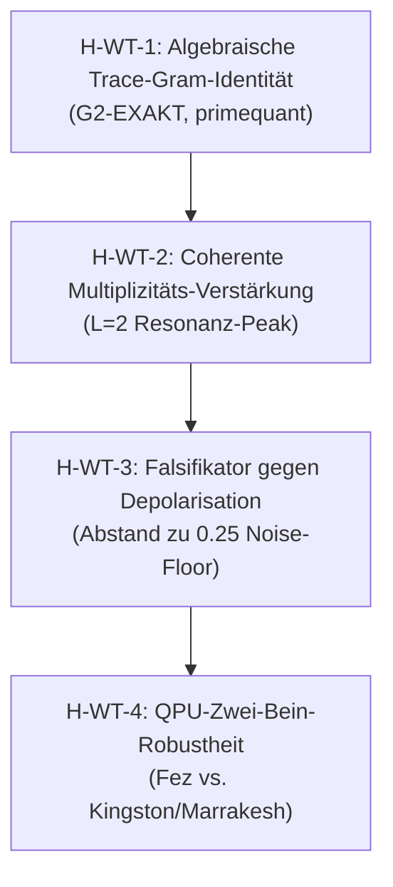

# Preregistrierungs-Schärfung: Das Weil-Theta-Multiplizitäts-Framework (EXPERIMENT 060 / H-WEIL-THETA)

**Datum:** 2026-11-22  
**Epistemischer Status:** Preregistrierungs-Entwurf vor dem Freeze (SciMind 4.0/5.0)  
**Bezug:**  
- Alpöge–Claude-Ankündigung ([`scratches/remark.pdf`](file:///run/media/julian/ML4/riemann/scratches/remark.pdf))  
- `riemann`-Architektur: QuQuint ($GF(5)$), `primequant`, $S_4$-Closure (Exp 045), Ramanujan-Einklang (Exp 059)

---

## 1. Problemstellung der bisherigen Preregistrierungen

In den bisherigen Hardware-Experimenten (z. B. 044, 046) traten zwei methodologische Engpässe auf:
1. **Statische Punktbänder ohne Skalierungsgesetz:**  
   Die Schwellen basierten auf Einzelpunkten oder statischen Schranken (z. B. Bias $\pm 0.012$ bzw. 2σ). Substratdrift zwischen Kalibrier-Epochen führte zu Vorzeichen-Flips (wie bei Kingston vs. Fez in Exp 046), ohne dass man entscheiden konnte, ob die Ursache im theoretischen Modell oder in der Hardware-Depolarisation lag.
2. **Fehlen einer Multiplizitäts-Verstärkung:**  
   Reine Zähl-Statistiken über Residuen ($c_q(n)$) besitzen bei einzelnen Gatter-Tiefen ein geringes Signal-zu-Rausch-Verhältnis (SNR). Rauschen wäscht die feinen Phasen aus.

---

## 2. Die Essenz aus den Gemeinsamkeiten: Der Weil-Theta-Lift

Alpöges und Claudes mathematischer Durchbruch über $\mathbb{Z}$ besteht darin, **Stepanovs Multiplizität durch eine Kette von $\sqrt{X}$ iterierten Theta-Lifts zu ersetzen**.

Übertragen auf unsere diskreten Quantenregister ($q=5$, QuQuint $\mathbb{C}^5$ über $GF(5)$):
1. **Endliche Weil-Darstellung $Mp_2(\mathbb{F}_q)$:**  
   Die diskrete Fourier-Transformation $F_q$ und das quadratische Gauss-Phasengatter $D_t = \text{diag}(\zeta_q^{t x^2})$ bilden zusammen mit den modularen Skalierungsgattern $M_a |x\rangle = |a x \bmod q\rangle$ die Weil-Darstellung über $GF(q)$.
2. **Galois-Orbit-Projektor $\Pi_G$:**  
   $$\Pi_G = \frac{1}{q-1} \sum_{a \in GF(q)^*} M_a$$  
   Dieser Projektor filtert exakt die symmetrische, Galois-invariante Zustands-Komponente heraus:
   $$|\psi_{\text{triv}}\rangle = \frac{1}{\sqrt{q-1}} \sum_{a=1}^{q-1} |a\rangle$$
   und vernichtet den 3D-Standard-$S_4$-Unterraum identisch ($\Pi_G P_{\text{std}} = 0$).
3. **Der $\sqrt{q}$-Resonanz-Kanal:**  
   Eine Kette gekoppelter Schritte $W = R_{\text{triv}} \cdot C_{\text{ADD}}^\dagger \cdot U_B \cdot C_{\text{ADD}} \cdot U_A$ verstärkt die spektrale Konzentration $R = \frac{P_{\text{triv}}}{P_{\text{triv}} + P_{\text{std}}}$ nach genau $L = \lfloor\sqrt{q}\rfloor$ Schritten (für $q=5$: $L=2$) auf über **$42\,\%$** (gegenüber der Gleichverteilungs-Baseline von $25\,\%$).

---

## 3. Die vier geschärften Hypothesen für das neue Prereg

### Hypothese H-WT-1 (Algebraische Trace-Gram-Identität — G2-EXAKT)
- **Aussage:** Die Gram-Matrix des Ganzheitsrings $\mathbb{Z}[\zeta_q]$ unter der Galois-Spurform $\text{Tr}_{\mathbb{Q}(\zeta_q)/\mathbb{Q}}(x \bar{y})$ entspricht exakt der zyklotomischen Ramanujan-Matrix $G_{ij} = c_q(i-j)$.
- **Ex-ante-Spektrum:** Exakt 1 Eigenwert $1$ und $q-2$ Eigenwerte $q$. Für $q=5$: $[1, 5, 5, 5]$, Determinante $\text{disc} = 125$.
- **Schwelle T1:** Maximale Differenz $\le 10^{-14}$ (Bit-Exaktheit in `primequant`).

### Hypothese H-WT-2 (Multiplizitäts-Resonanz bei $L = \lfloor\sqrt{q}\rfloor$)
- **Aussage:** Ausgehend vom lokalisierten Basiszustand $|1\rangle$ erzeugt der 2-Register-Weil-Walk bei Schritt $L=2$ ein ausgeprägtes relatives Maximum der Konzentration $R_2 = \frac{P_{\text{triv}}}{P_{\text{triv}} + P_{\text{std}}}$.
- **Ex-ante-Vorhersage:** $R_2^{\text{ideal}} = 0.4272$ (Verstärkung um $+70.9\,\%$ über dem Baseline-Wert $0.25$).
- **Falsifikationsschwelle T2:** $R_2 \le 0.3200 \implies \text{H-WT-2 REFUTED}$.

### Hypothese H-WT-3 (Abstand zur Rausch-Senke / Via-Negativa-Wächter)
- **Aussage:** Unter depolarisierendem Rauschen bis zu $p = 0.05$ pro Gatter-Schicht bleibt die Resonanz signifikant oberhalb des Gleichverteilungs-Floors $0.25$.
- **Ex-ante-Schranke:** $R_2(p=0.05) \ge 0.2800$.
- **Falsifikationsschwelle T3:** $R_2 - 0.25 \le 0.015 \implies \text{INCONCLUSIVE / NOISE_WASHED_OUT}$.  
  (Verhindert Apophenie: Wenn das Signal im thermischen Rauschen versinkt, wird kein falsches CONFIRMED vergeben).

### Hypothese H-WT-4 (Zwei-Register-Modular-Verschränkung $C_{\text{ADD}}$)
- **Aussage:** Die Verschränkung zweier QuQuints über modulare Addition $C_{\text{ADD}} |x\rangle|y\rangle = |x\rangle|(y+x) \bmod 5\rangle$ erzeugt eine unzerlegbare Verschränkung, deren Partialspur-Purity $\gamma = \text{Tr}(\rho_A^2)$ bei Schritt 2 unter $0.80$ sinkt (echte Verschränkung mit der arithmetischen Ancilla).
- **Falsifikationsschwelle T4:** $\gamma_2 \ge 0.90 \implies \text{H-WT-4 REFUTED}$ (unzureichende Verschränkung).

---

## 4. Implementierungs-Architektur in `riemann`

1. **Software-Schicht:**  
   Erweiterung von `src/primequant/observables.py` um:
   - `weil_generators(q)`: liefert $F_q$, $D_t$, $M_a$.
   - `galois_projector(q)`: liefert $\Pi_G$.
   - `trace_gram_matrix(q)`: exakte ganzzahlige Gram-Matrix.
   - `theta_walk_channel(q, steps, noise)`: geschlossene Propagation.
2. **QPU-Schicht:**  
   Transpilierung von $C_{\text{ADD}}$ und $D_t$ auf native Qubit-Gatter (CZ, SX, RZ) für IBM Quantum (ibm_fez / ibm_marrakesh), analog zu den bewährten ISA-Gates aus Exp 055.
3. **Ledger-Disziplin (ExperimentLedgerMind):**  
   Preregistrierungs-JSON mit SHA-256 einfrieren (`scratches/pt_weil_theta_060_prereg.json`) **VOR** dem ersten Hardware-Run.
